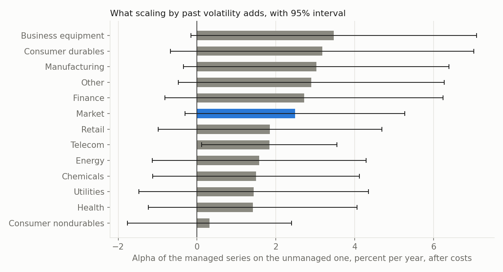

# Do volatility regimes change risk, and can you use that?

[](https://github.com/rxj0102/Regime-Analysis/actions/workflows/ci.yml)

**Question.** Everyone agrees markets have calm and turbulent regimes. Three things follow if that matters: risk should differ between regimes in a way you can know in advance, betas should move, and an investor who cuts exposure in the turbulent regime should do better. Which of the three survive a century of data?

<!-- headline:start (generated by scripts/render_readme.py, do not edit by hand) -->
**Answer, from 25,057 days since 1930: regimes change risk a great deal, and that turns out to be very hard to use.** Market volatility is 22% a year in the High regime against 10% in the Low one, and the regime is known the day before. The average return is not detectably different (t = 0.8), so the Sharpe ratio is 0.63 in calm markets and 0.43 in turbulent ones. Betas shift for 7 of 12 industries, the largest by 0.15. Yet scaling exposure down when volatility is high, in real time with leverage capped at 2x, adds 2.5% a year of alpha to the market with t = 1.7, moves its Sharpe ratio from 0.48 to 0.50 (95% interval for the change -0.15 to +0.19), and is significant for none of the 13 series once they are counted. The textbook version, with the scaling constant chosen in hindsight and no leverage limit, gives t = 2.2.
<!-- headline:end -->

Every number on this page is written by `scripts/reproduce.py`, and CI reruns the study and fails if the page and the results disagree.



## Results

<!-- results:start (generated by scripts/render_readme.py, do not edit by hand) -->
Daily data 1926-07-01 to 2026-09-30. Regime labels start 1930-10-27 after a five year warm-up; managed portfolios run monthly from 1931-08 to 2026-09 (1,142 months).

### 1. The market in each regime

| Regime | Days | Return per year | Volatility | Sharpe | 99% one day loss | Worst day |
|---|---|---|---|---|---|---|
| Low | 12,852 | +6.6% | 10.4% | 0.63 | 1.9% | -7.1% |
| High | 12,205 | +9.3% | 21.8% | 0.43 | 3.8% | -17.4% |

High days are 49% of the sample and a spell in one regime lasts 30 trading days on average. Difference in return, High minus Low: +2.7% a year, t = 0.76.

### 2. Industry betas in each regime

| Industry | Beta, Low | Beta, High | Change | t | p, Holm |
|---|---|---|---|---|---|
| Finance | 0.94 | 1.09 | +0.15 | +9.6 | 0.000 |
| Telecom | 0.62 | 0.77 | +0.15 | +8.8 | 0.000 |
| Utilities | 0.70 | 0.75 | +0.05 | +2.3 | 0.108 |
| Retail | 0.88 | 0.91 | +0.03 | +3.2 | 0.010 |
| Health | 0.78 | 0.80 | +0.02 | +1.4 | 0.640 |
| Business equipment | 1.26 | 1.27 | +0.00 | +0.3 | 1.000 |
| Consumer nondurables | 0.69 | 0.69 | +0.00 | +0.1 | 1.000 |
| Chemicals | 0.90 | 0.90 | +0.00 | +0.0 | 1.000 |
| Other | 1.11 | 1.06 | -0.05 | -3.8 | 0.001 |
| Energy | 0.99 | 0.94 | -0.06 | -2.7 | 0.045 |
| Manufacturing | 1.17 | 1.11 | -0.06 | -5.0 | 0.000 |
| Consumer durables | 1.32 | 1.25 | -0.07 | -3.5 | 0.004 |

### 3. Using it: volatility managed portfolios

Real time scaling, leverage capped at 2x, 5 bps per unit of change in exposure. Alpha is the intercept of the managed series on the unmanaged one.

| Series | Alpha per year | t | p, Holm | Sharpe, unmanaged | Sharpe, managed | Change, 95% interval | Worst drawdown, unmanaged | managed |
|---|---|---|---|---|---|---|---|---|
| Market | +2.5% | +1.74 | 0.86 | 0.48 | 0.50 | +0.02 [-0.15, +0.19] | -64% | -77% |
| Consumer nondurables | +0.3% | +0.30 | 1.00 | 0.53 | 0.41 | -0.12 [-0.27, +0.04] | -58% | -69% |
| Consumer durables | +3.2% | +1.62 | 0.86 | 0.39 | 0.39 | +0.00 [-0.15, +0.16] | -77% | -75% |
| Manufacturing | +3.0% | +1.76 | 0.86 | 0.44 | 0.46 | +0.01 [-0.13, +0.17] | -70% | -81% |
| Energy | +1.6% | +1.14 | 1.00 | 0.47 | 0.42 | -0.05 [-0.19, +0.09] | -67% | -70% |
| Chemicals | +1.5% | +1.12 | 1.00 | 0.44 | 0.41 | -0.02 [-0.16, +0.13] | -67% | -63% |
| Business equipment | +3.5% | +1.88 | 0.73 | 0.44 | 0.47 | +0.03 [-0.13, +0.19] | -82% | -86% |
| Telecom | +1.8% | +2.09 | 0.47 | 0.40 | 0.46 | +0.06 [-0.18, +0.29] | -77% | -53% |
| Utilities | +1.4% | +0.97 | 1.00 | 0.38 | 0.35 | -0.03 [-0.22, +0.16] | -72% | -89% |
| Retail | +1.8% | +1.28 | 1.00 | 0.49 | 0.47 | -0.02 [-0.18, +0.13] | -66% | -77% |
| Health | +1.4% | +1.05 | 1.00 | 0.51 | 0.46 | -0.05 [-0.19, +0.10] | -65% | -68% |
| Finance | +2.7% | +1.51 | 0.92 | 0.42 | 0.43 | +0.01 [-0.14, +0.15] | -74% | -80% |
| Other | +2.9% | +1.68 | 0.86 | 0.34 | 0.38 | +0.04 [-0.11, +0.20] | -77% | -75% |

The managed market holds 1.14 times the market on average, is at the cap in 24% of months and changes its exposure by 4.6 times capital a year.

**What each realistic constraint costs, for the market**

| Version | Alpha per year | t | Largest exposure |
|---|---|---|---|
| Hindsight scaling, no cap, no costs | +3.6% | +2.23 | 14.8x |
| Real time scaling, no cap, with costs | +3.6% | +1.54 | 17.1x |
| Real time scaling, 2x cap, no costs | +2.7% | +1.91 | 2.0x |
| Real time scaling, 2x cap, with costs (reported above) | +2.5% | +1.74 | 2.0x |

**The managed market by third of the sample**

| Period | Alpha per year | t | Sharpe, unmanaged | Sharpe, managed |
|---|---|---|---|---|
| 1931-08 to 1963-03 | +5.3% | +1.54 | 0.51 | 0.59 |
| 1963-04 to 1994-12 | +0.3% | +0.18 | 0.32 | 0.29 |
| 1995-01 to 2026-09 | +2.8% | +1.87 | 0.62 | 0.70 |
<!-- results:end -->

## Reading the results

- **Risk is forecastable, return is not.** Yesterday's regime tells you tomorrow's volatility will be about twice as high. It tells you nothing reliable about tomorrow's return. A century of daily data is enough to measure the first to two digits and not enough to sign the second.
- **Lower Sharpe in turbulent markets does not make timing pay.** The Sharpe ratio is lower in the High regime, which is the whole case for cutting exposure there. But the managed market's Sharpe ratio improves by a few hundredths with an interval that runs well to either side of zero.
- **The published result leans on hindsight.** With the scaling constant picked using the full sample and exposure allowed to go as high as it likes, the market's alpha is significant. Picking the constant from past data alone takes it below significance, with or without a leverage cap. Costs matter little.
- **Management did not protect the downside here.** The managed market's worst drawdown is deeper than the unmanaged one. Exposure is highest after long calm stretches, which is when the next shock arrives at full size.
- **Beta shifts are real and small.** Finance and telecom gain about 0.15 of beta in turbulent markets, and manufacturing and durables lose a little. Statistically clear, economically minor next to a doubling of market volatility.
- **Thirteen tests, one sample.** The industries are highly correlated with the market, so the 13 managed series are closer to one experiment than thirteen. All 13 alphas being positive is weaker evidence than it looks.

## Design

| Choice | What and why |
|---|---|
| Data | Daily excess returns of the US market and the 12 Fama-French industries, July 1926 to September 2026, from the Ken French Data Library. |
| Regime | Day t is High when the market's 22 day volatility ending t-1 is above the median of that measure over all days up to t-1. The first five years only warm up the median. |
| Risk by regime | Return, volatility, Sharpe ratio, 99% one day loss. Difference in mean return tested with Newey-West errors. |
| Betas | One regression per industry with a regime interaction, Newey-West errors, Holm correction across the 12. |
| Managed portfolios | Monthly. Exposure is a constant over last month's realised variance, capped at 2x. The constant is set each month so the managed series would have matched the unmanaged one's volatility over all earlier months. |
| Costs | 5 bps per unit of change in exposure. |
| Tests | Alpha of managed on unmanaged with Newey-West errors, Holm across 13 series; Sharpe difference by paired block bootstrap. |

**One change after the first run.** The first version set the scaling constant to the average of past monthly variances. Variance is so skewed that this held 1.6 times the market on average and sat at the cap in 63% of months, which is a leveraged portfolio, not a managed one. It was replaced by the volatility matching rule above. The conclusion did not move: the market's alpha t-statistic was 1.78 before the change and is in the table now. The hindsight row was added at the same time, as a comparison.

## What was wrong with the first version

It used five years of data (2019 to 2023) and four series. Its point-in-time regime rule labelled 68% of those days High, so the Low regime was a few hundred days and the reported Sharpe differences between regimes were noise. It then added GARCH fits, a value-at-risk backtest and two stress windows, none of which tested whether the regime was useful. The rebuild keeps the regime rule, runs it on a century, and asks the one question that matters.

## Limits

- One regime definition. A two state split on trailing volatility is the simplest choice; nothing here tests hidden Markov or macro regimes.
- US equities only, and value weighted portfolios. Moreira and Muir find larger gains for some other factors, which are not tested here.
- Monthly rebalancing on last month's variance. Faster signals or better variance forecasts might do more.
- The leverage cap of 2x and the 5 bps cost are one choice each.

## Reproduce

```bash
pip install -r requirements.txt
python -m pytest -q               # tests
python scripts/reproduce.py       # a few seconds, rewrites results/
python scripts/render_readme.py   # rewrites this page; --check compares only
```

Returns are frozen in `data/snapshot/daily_excess_returns.csv.gz`. `python -m src.data` downloads them again.

## Layout

```
src/data.py      Ken French loader and the frozen snapshot
src/study.py     regime rule, regressions, managed portfolios, statistics
scripts/         reproduce.py writes results/, render_readme.py writes this page
tests/           look-ahead, regression and accounting checks
```

## References

- Cederburg, S., O'Doherty, M., Wang, F. and Yan, X. (2020). On the performance of volatility-managed portfolios. *Journal of Financial Economics* 138(1).
- Moreira, A. and Muir, T. (2017). Volatility-managed portfolios. *Journal of Finance* 72(4).
- Newey, W. and West, K. (1987). A simple, positive semi-definite, heteroskedasticity and autocorrelation consistent covariance matrix. *Econometrica* 55(3).
